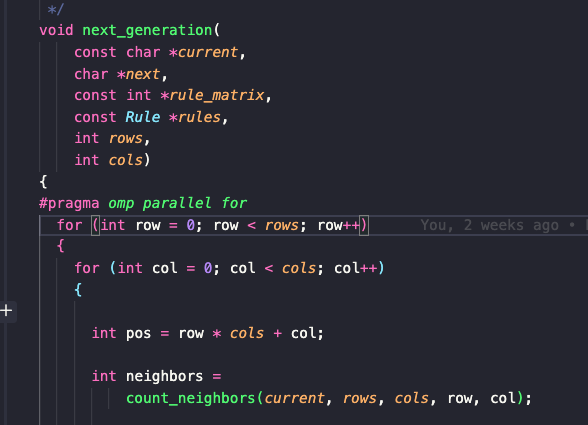

# Paralelização por Linha
1. Paralelizamos a execução do cálculo do next grid por linha, dividindo o número de linhas para o número de threads disponíveis executarem em paralelo.

2. Foi observado que nessa solução inicial, as entradas de teste cedidas eram tão pequenas que o overhead de gerenciamento das threads era maior do que a rapidez ganhada pelo paralelismo, causando um speedup menor que 1, então, geramos entradas de teste bem maiores.
3. Agora, com uma entrada de teste maior (life-6.in), foi observado um speedup de 3.36
4. Tweak no tamanho do chunk do schedule()
com static: 2.527s
com dynamic chunkSize 15: 2.054

# Paralelização por Coluna
1. Agora, paralelizamos o cálculo do next grid por coluna, utilizando a mesma divisão de threads que a estratégia anterior.
2. Observamos uma diminuição drástica no desempenho em comparação com a paralelização por linha, e um aumento timido comparando com a versão serial. Essa diminuição vem por conta do layout de memória da grade, armazenada em ordem row-major, conforme a indexação grid[row * cols + col]. Assim, Células de uma mesma linha ocupam posições contíguas na memória, enquanto células de uma mesma coluna estão separadas por um passo (stride) de cols elementos.
Ao dividir o trabalho por colunas, cada thread acessa a memória com esse passo grande. Cada cache line (64 bytes) carregada é aproveitada em poucos bytes, o que aumenta o tráfego de memória e os cache misses.
3. Foi anotado um speedup de 1.33

# Cache de celulas vivas + paralelização da cache
## 1. ideia
Esse teste consiste em mudar a estrutura do código para extrair maior eficiencia da paralelização. Nesse caso, mudamos a lógica para que o programa guardasse uma "Cache" com as celulas vivas, e fizesse as gerações e avaliações apenas nessas celulas e nas suas vizinhas, com o objetivo de eliminar analises desnecessárias.
## 2 - Implementação da cache 
Para o desenvolvimento da ideia, primeiramente foi implementado a struct `AliveCache`, contendo:
`alives` - Vetor que mantem as celulas vivas atuais
`next_alives` - Vetor que receberá as celulas que estarão vivas na proxima geração
`candidates` - Lista de celulas que serão avaliadas
`marked` - Flag para verificar se a celula já foi analisada na geração
`thread_buffers` - Buffers privados de cada thread OpenMP para escrita sem lock
`count` - Contador de quantas celulas vivas tem em alive

Essa estrutura ajudou a deixar o código mais organizado para a implementação. Ela é inicializada no inicio do main e recebe os parametros iniciais antes do começo do jogo.

### 2.1 - mudança no next_generation
1. A função `next_generation` agora passa a considerar apenas as posições em **alive** para analise das regras. Então, a função inicia mapeando as celulas candidatas a sofrerem mudanças, isso é, as celulas agora vivas e suas vizinhas, e coloca no vetor `candidates`. Após isso, o programa aplica as regras apenas nas posições que são candidatas a sofrer modificação. 
2. Caso a celula venha a nascer ou sobreviva, ela é colocada no vetor `local_alives`, esse é um vetor exclusivo de cada thread para guardar as celulas vivas na sua partição da geração, que depois são unidos em `next_alives`. Essa estratégia foi adotada para evitar a disputa para escrita no ponteiro global `next_alives`. Assim, cada thread escreve exclusivamente no seu buffer sem nenhuma disputa por zona critica, e ao final, une todos os buffers no vetor global. 
3. Depois de definir as novas celulas vivas, o programa limpa o vetor `current`, para a proxima geração, e inverte os ponteiros de `next_alives` com `alives`. Assim, `alives` passa a apontar para o vetor com as celulas vivas atuais (`next_alives`) e conclui a geração. 

### 2.2 - Paralelização
Utilizamos do OpenMP para paralelizar, principalmente, a analise das celulas em cada geração e a limpeza do buffer `current`.

1. Na analise das celulas, abrimos a area paralela com `#pragma omp parallel` e definimos o buffer de cada thread.

2. Para a paralelização da analise dos candidatos, a partição de cada thread foi dividida igualmente na clausula `schedule(static)`, buscando o maior equilibrio entre o trabalho de cada thread. Isso também elimina o **overhead** de sincronização, já que as partições já são fatiadas para cada thread.

3. Utilizamos também a clausula `nowait` no `parallel for`, essa estratégia foi pensada para as threads que terminam sua partição de candidatos não fiquem ociosas esperando as demais, assim, ela já avança para a descarga de suas celulas vivas em `next_alives` e reduz o tempo de CPU desperdiçado. Nessa estratégia, observamos um ganho leve de rendimento em todos os testes, aproximadamente 1,13 de speedup comparando com o sem `nowait`, por isso resolvemos manter.

4. Para a escrita de cada celula no vetor global `next_alives`, usamos o comando `#pragma omp atomic capture`. Essa clausula faz uma reserva imediata de posições no buffer global para cada thread, assim o descarregamento das celulas pode ser feito em paralelo sem conflito, pois as posições não se sobrepõem. Em uma versão inicial, testamos usando `#pragma omp critical` para fazer a escrita no vetor global. Porém, o comando fazia com que cada thread esperasse a sua vez de escrever no buffer e **serializava** esse trecho do código, o que resultava em um menor desempenho.

5. Por fim, para efetuar a limpeza do buffer `alives` de forma veloz, foi utilizado a paralelização com a clausula `schedule(static)`, para que cada thread limpe partes iguais do vetor.

### 3. Conclusão
1. Essa estratégia foi a que apresentou os melhores resultados entre todas as testadas, pois uniu uma grande redução de trabalho, processando apenas células ativas em vez da matriz inteira, com um modelo de paralelismo sem contenção de travas e disputa por recursos.
2. Com entradas maiores, a diferença de desempenho se tornou ainda mais evidente. Enquanto as versões anteriores calculavam toda a grade L x C a cada geração, esta solução escala apenas com a quantidade de células ativas, eliminando o tráfego desnecessário de memória.
3. No teste com o arquivo `life-6.in`, foi observado um speedup de **8.59** (com picos de **9.66**) em relação à versão serial, sendo cerca de **3.5x** mais rápido que a paralelização por linha.
4. No teste com o arquivo mais pesado (`life-7.in`), foi anotado um speedup de **14.96** (com picos de **17.13**) em relação ao serial, superando em mais de **6x** a versão paralelizada por linha.

# Para testar
1. Paralelizar por coluna. Testar qtd de threads, quantas colunas para cada thread, se há uma razão calculável que sempre seja boa

2. Uma ideia é ter uma thread especializada para cada tipo de regra. Mas supondo que possa ter mais células de uma regra específica, devemos ter mais threads para essa regra. 

3. Testar a possibilidade de armazenarmos um "cache" que tem células vivas a fim de não precisarmos em toda geração calcular todas as células possíveis da matriz. Ex.: só temos algumas células no canto superior direito, não precisamos calcular o canto inferior esquerdo.

